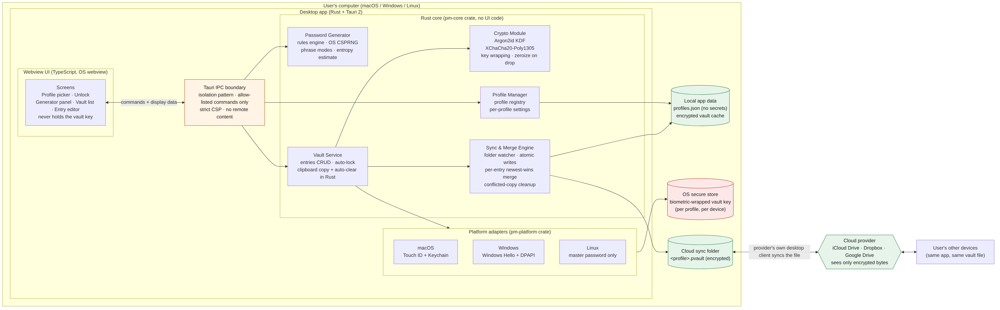
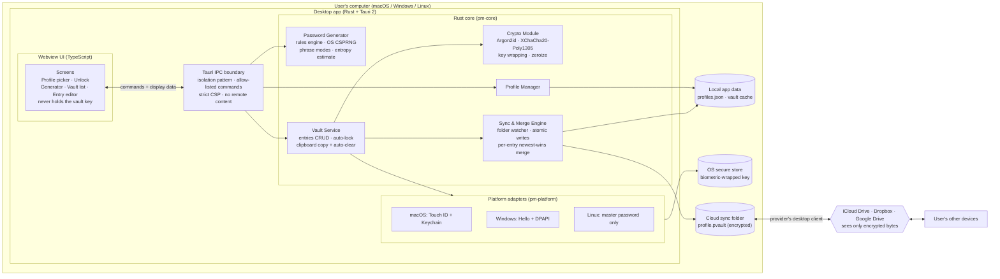
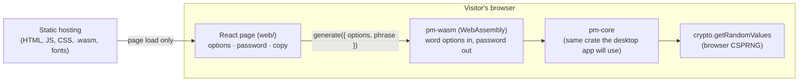
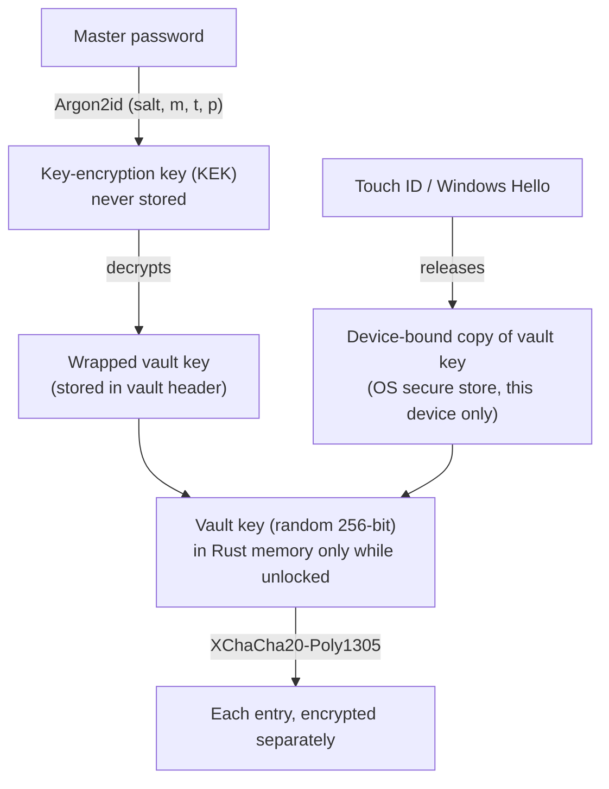
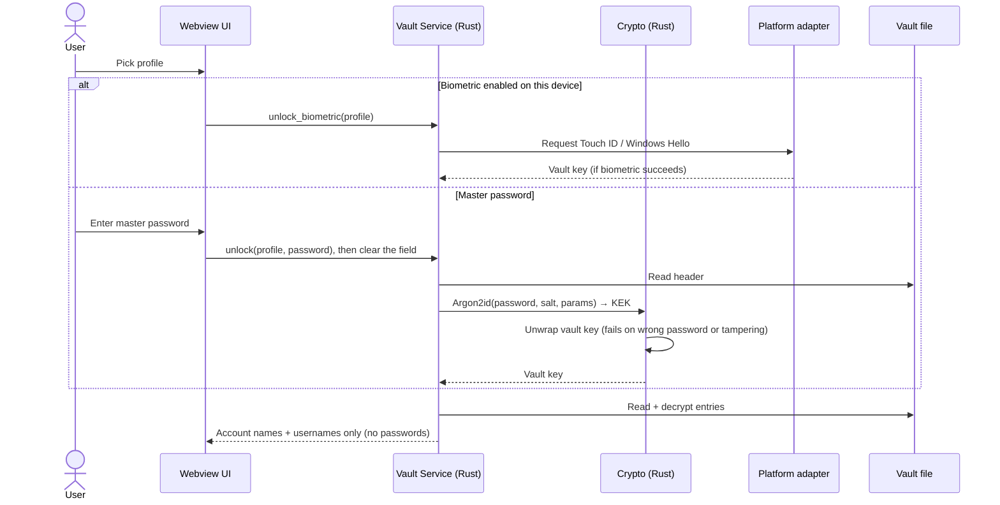
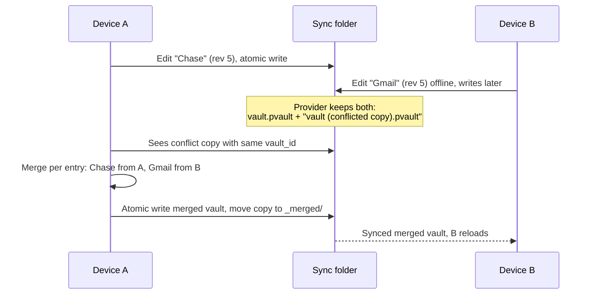

# Password Generator & Manager — Architecture

**Status:** Design draft v2 · 2026-10-19 (v1 used Python; v2 switches to Rust + Tauri; v0.1 ships as a website first)
**Platform:** v0.1: website (Rust compiled to WebAssembly + React). Then: desktop app, Rust + Tauri 2, macOS / Windows / Linux

This document describes what the app does, how it is built, and how it keeps passwords safe. Every design choice is labeled:

- **✅ Confirmed** — you chose this.
- **🟡 Proposed** — my recommendation. It needs your OK before building. All of these are collected in [Section 13: Open questions](#13-open-questions-need-your-answer-before-building).

---

## 1. Confirmed decisions

| Topic | Your answer |
|---|---|
| Platform | ✅ Website first (v0.1: generator only), then the desktop app (vault and everything else). Decided 2026-10-19. |
| Stack | ✅ Rust with Tauri 2: Rust core, UI in HTML/CSS/TypeScript rendered by the OS webview |
| Operating systems | ✅ macOS, Windows, Linux |
| Storage | ✅ Synced through cloud storage: iCloud Drive, Dropbox, Google Drive |
| Users | ✅ Multiple separate users. Both profiles on one shared install, and each user's vault syncs to their own devices |
| Unlock | ✅ Master password, plus biometrics (Touch ID on macOS, Windows Hello on Windows) |
| Entry fields | ✅ Account name, username/email, password |
| Phrase use | ✅ User chooses per password: **Transformed** (phrase mixed in with substitutions and random characters) or **As-is** (phrase verbatim plus random characters) |
| Generator rule options | ✅ Length min/max, uppercase/lowercase, special characters, exclude look-alikes and repeats, plus the most common site requirements from research (Section 4.1) |
| Sync conflicts | ✅ Merge per entry, newest edit wins |
| Frontend framework | ✅ React (TypeScript) |
| Phrase rules | ✅ Transformed mode swaps letters for symbols only, never digits. Phrases containing digits are rejected. A phrase that breaks any rule is rejected with a message, never edited silently (Section 4.4). |
| First release (v0.1) | ✅ A website that generates **memorable** passwords: 2 or 3 words joined by digits and special characters (Section 4.6). Options: length range, exact digits, uppercase and lowercase switches, special characters required with selectable symbols, and the person's own words or random words. Regenerate on request. No spaces, ever. Decided 2026-10-19; replaces the random-character page. The random-character generator (Sections 4.1–4.5) stays in `pm-core`, tested, for the desktop app. Vault and accounts come later (Section 11). |
| Website colors | ✅ Dark grey, lime green, light grey, mustard yellow |
| Copy button | ✅ Desktop: copy and automatic clear done in Rust. Website (v0.1): the browser clipboard, cleared after 30 seconds only if it still holds the password (Section 3.4). |
| License | ✅ None for now (all rights reserved by default). |

### 1.1 Why Rust instead of Python

The first draft of this design used Python with PySide6 (Qt). It now uses Rust with Tauri. What changes:

| | Python + PySide6 (v1) | Rust + Tauri (v2) |
|---|---|---|
| Wiping secrets from memory | Not reliably possible; Python strings are immutable and copied freely | Keys and secrets are wiped on drop (`zeroize`, `secrecy` crates) in the Rust core |
| Windows Hello | Through `pywinrt`, thinly documented | Through Microsoft's official `windows` crate |
| Distribution | Bundles a Python interpreter (PyInstaller/Briefcase), larger installers | One native binary that uses the OS's built-in webview, smaller installers |
| Correctness | Errors found at runtime | Many errors caught at compile time (types, exhaustive matching, no null) |
| Crypto | libsodium via PyNaCl | Pure-Rust RustCrypto crates (Section 5.3) |

**What it costs:**
- **Two languages:** Rust for the core, TypeScript for the UI.
- **A security boundary between them.** The UI runs in a webview, so the design must control exactly what crosses into it (Section 3.3).
- **Rust's learning curve** is steeper than Python's.
- **Linux webview dependency:** on Linux, Tauri depends on WebKitGTK, which the user's distribution supplies.

---

## 2. Scope

### In scope
1. **Password generator** — user picks rules from a list of common site requirements, sets the exact number of digits, optionally enters a memorable phrase, and generates. "Regenerate" makes a fresh password with the same settings.
2. **Password vault** — encrypted storage of entries (account name, username/email, password). Create, view, edit, delete, search, copy.
3. **Multi-user profiles** — several people on one install, each with their own vault and master password.
4. **Cloud sync** — each vault is one encrypted file in the user's cloud sync folder. The provider only ever stores ciphertext.
5. **Biometric unlock** on macOS and Windows.

### Out of scope (not planned unless you add them)
- Browser autofill or a browser extension
- Mobile apps (Tauri can target mobile later, but this design doesn't cover it)
- Shared vaults between users
- Password history (you didn't select it; see the overwrite warning in Section 13, Q9)
- Website URL and notes fields
- Our own server. The app has no backend.

---

## 3. Architecture



The same diagram as Mermaid source (renders on GitHub):



### 3.1 Components

| Component | Responsibility | Touches secrets? |
|---|---|---|
| **Webview UI** (TypeScript) | Screens and user input only. No crypto, file, or clipboard logic. | Sees the master password while it's typed, and a single password only when the user clicks "show". Never holds the vault key. |
| **IPC command layer** (`src-tauri`) | The only bridge between the UI and the Rust core. A short, fixed list of Tauri commands (e.g. `unlock`, `generate`, `list_entries`, `copy_password`). Validates every input. | Passes them through; never logs them |
| **Password Generator** | Builds passwords from a rule set using the OS CSPRNG. Estimates strength. Pure functions, easy to test. | Produces them |
| **Vault Service** | Holds the unlocked vault in Rust memory, handles entry CRUD, the auto-lock timer, clipboard copy and auto-clear. | Yes |
| **Crypto Module** | Key derivation, encryption, decryption, key wrapping. The only module that uses crypto crates. Secret types wipe themselves on drop. | Yes |
| **Sync & Merge Engine** | Reads and writes the vault file, watches it for changes made by other devices, merges, cleans up provider conflict copies. Only ever writes **ciphertext** to disk. | Ciphertext only on disk |
| **Profile Manager** | Lists profiles and where each profile's vault file lives. Stores **no secrets**. | No |
| **Platform adapters** | One Rust trait (`BiometricUnlock`) with a macOS, Windows, and Linux implementation, chosen at compile time with `#[cfg(target_os = ...)]`. | Wrapped key only |

### 3.2 Proposed project layout 🟡

A Cargo workspace. The core logic lives in plain library crates with no Tauri dependency, so it can be tested and used from a CLI on its own.

```
password-manager/
├── Cargo.toml                    # workspace: lists the crates below
├── crates/
│   ├── pm-core/                  # all app logic, no UI, no Tauri
│   │   ├── data/
│   │   │   └── common-passwords.txt  # bundled blocklist (placeholder in v0.1)
│   │   ├── src/
│   │   │   ├── lib.rs
│   │   │   ├── generator/        # ✅ built in v0.1
│   │   │   │   ├── policy.rs     # PasswordPolicy struct + validation
│   │   │   │   ├── charsets.rs   # character pools, look-alike lists
│   │   │   │   ├── engine.rs     # generate() (regenerate = call again)
│   │   │   │   ├── phrase.rs     # transformed / as-is phrase handling
│   │   │   │   ├── rules.rs      # repeat, sequence, username, common-password checks
│   │   │   │   ├── error.rs      # user-facing error messages
│   │   │   │   └── strength.rs   # entropy estimate + rating
│   │   │   ├── crypto.rs         # later: KDF, AEAD, key wrapping
│   │   │   ├── vault.rs          # later: Vault, Entry models + CRUD
│   │   │   ├── vault_format.rs   # later: file serialization, versioning
│   │   │   ├── sync.rs           # later: watcher, atomic write, merge
│   │   │   └── profiles.rs       # later
│   │   └── tests/
│   │       └── properties.rs     # property tests: every password follows every rule
│   ├── pm-platform/              # biometric + OS secure storage
│   │   └── src/
│   │       ├── lib.rs            # BiometricUnlock trait
│   │       ├── macos.rs
│   │       ├── windows.rs
│   │       └── linux.rs
│   └── pm-cli/                   # optional, later: command-line generator
├── src-tauri/                    # the desktop app shell
│   ├── src/
│   │   ├── main.rs
│   │   ├── commands.rs           # every IPC command, in one file
│   │   └── clipboard.rs
│   ├── capabilities/default.json # what the UI is allowed to call
│   └── tauri.conf.json           # CSP, isolation pattern, bundling
├── ui/                           # frontend (TypeScript)
│   ├── package.json
│   └── src/
└── tests/                        # cross-crate integration tests
```

### 3.3 Webview security boundary 🟡

In Tauri, the UI is a web page running in the OS webview, and the Rust core is a separate side of the app. Treat the webview as the **less trusted side**: any bug or compromised npm dependency there runs JavaScript. The rule is that **secrets stay in Rust and only the minimum crosses into the webview.**

| What | Where it lives | What the webview gets |
|---|---|---|
| Vault key, KEK, decrypted vault | Rust only | Nothing |
| Entry list | Rust | Account names and usernames, **no passwords** |
| A stored password | Rust | Only when the user clicks "show", for that one entry. Hidden again after 30 s 🟡 or on lock. |
| Copy to clipboard | Done in Rust | Nothing. The UI sends `copy_password(entry_id)` and Rust copies, so the password never enters JavaScript. |
| Generated password | Rust | The candidate, so the user can see it before saving. The UI saves by sending it back with the account details. |
| Master password | Typed in the webview | Sent to Rust once on submit, then the input field is cleared. JavaScript memory can't be reliably wiped, so this is a known, small exposure. |

**Hardening settings:**
- **Isolation pattern on.** Tauri routes every IPC message through a small sandboxed script that can validate it, and encrypts it with a key generated each time the app starts.
- **Capabilities:** the UI may call only this app's own commands. The core plugins that would expose the file system, shell, or HTTP are not granted to the UI.
- **Strict Content Security Policy:** no remote scripts, no `eval`, no inline scripts. All UI assets are bundled; the app loads no remote web content.
- **Small frontend dependency tree,** with a committed lockfile and `npm audit` in CI. Rust dependencies checked with `cargo audit` and `cargo deny`.

### 3.4 v0.1: the website ✅

v0.1 is a static website with the generator only. It reuses `pm-core` unchanged by compiling it to WebAssembly, so generation happens in the visitor's browser and no server ever sees a password.



- **`crates/pm-wasm`:** a thin wrapper around `pm-core`'s word-based generator (Section 4.6). It passes the page's options and words straight to the Rust rules, and returns either a password with its word count and strength, or an error with a plain-English message and the form field to highlight. It never throws.
- **Randomness:** `pm-core` asks for the OS random number generator; in the browser, getrandom's `wasm_js` backend supplies `crypto.getRandomValues`.
- **`web/`:** Vite + React + TypeScript. Fonts are bundled, not fetched from a font service.
- **Content Security Policy** (built pages only): everything from the site itself; no inline scripts or styles, no `eval`, no external requests. `'wasm-unsafe-eval'` is the one addition, needed to run WebAssembly. Asset inlining is turned off so fonts are never `data:` URLs.
- **Hosting:** any static host. GitHub Pages is planned in step 4 (Section 11).

**What the website can't do that the desktop app will:**

| | Website (v0.1) | Desktop app |
|---|---|---|
| Copy + clear | Browser clipboard. After 30 s the page clears it **only if it still holds the password**, so something else copied in the meantime is never erased. Some browsers don't let pages read the clipboard; then nothing is cleared and the page says so. Works only while the tab is open. | Done in Rust, without those limits. |
| Wiping secrets from memory | `zeroize` runs inside WebAssembly, but the password is also a JavaScript string on the page, which can't be wiped. | Rust memory wiped; only revealed passwords reach the webview (Section 3.3). |
| Storing passwords | Never. Nothing is saved. | Encrypted vault (Section 5). |

---

## 4. Password generator

### 4.1 Requirement options

Researched from NIST SP 800-63B-4 (final, July 2025) and large-scale studies of real website password policies (Georgia Tech, 20K+ sites; Princeton, 120 top sites). An important nuance: NIST now says *websites* shall not force composition rules, but most sites still do. So the generator must be able to **satisfy** whatever rules a site demands.

| # | Option | Control | Proposed default 🟡 |
|---|---|---|---|
| R1 | Minimum length | number | 16 |
| R2 | Maximum length (many sites cap at 16, 20, 32 or 64) | number | 64 |
| R3 | Require uppercase letter(s), with minimum count | toggle + number | On, 1 |
| R4 | Require lowercase letter(s), with minimum count | toggle + number | On, 1 |
| R5 | **Exact number of digits** (your requirement) | number (0–N) | 3 |
| R6 | Require special character(s), with minimum count | toggle + number | On, 1 |
| R7 | Allowed special-character set (sites often allow only some symbols) | editable set, with presets | `!@#$%^&*-_=+?` |
| R8 | No spaces | toggle | On |
| R9 | Must start with a letter | toggle | Off |
| R10 | Exclude look-alike characters (`0 O o`, `1 l I \|`, `5 S`, `2 Z`) | toggle | Off |
| R11 | No more than N identical characters in a row (e.g. `aaa`) | toggle + number | On, 2 |
| R12 | No sequential runs of 3+ (e.g. `abc`, `321`, `qwe`) | toggle | On |
| R13 | Must not contain the username/email (or its local part) | automatic when the entry has one | On |
| R14 | Must not be on a common/breached password list | automatic | On (always) |
| R15 | ASCII only (some sites reject accented letters and emoji) | toggle | On |
| R16 | Not already used by another entry in this vault | automatic warning | On |

Sites also commonly say "can't match your last N passwords" or "must be changed every 90 days". The app can't check those (the site enforces them) and they aren't generator rules, so they're left out.

**Saved rule presets 🟡:** let users save a rule set (e.g. "My bank: 8–20 chars, symbols `!@#$` only") and reuse it.

### 4.2 Inputs

```rust
pub struct PasswordPolicy {
    pub min_length: usize,
    pub max_length: usize,
    pub target_length: usize,          // what the user picks, within min..=max
    pub min_upper: usize,              // 0 = not required
    pub min_lower: usize,
    pub exact_digits: usize,           // R5
    pub min_symbols: usize,
    pub allowed_symbols: BTreeSet<char>,
    pub no_spaces: bool,
    pub start_with_letter: bool,
    pub exclude_lookalikes: bool,
    pub max_repeat: Option<usize>,     // R11, None = off
    pub no_sequences: bool,            // R12
    pub ascii_only: bool,
}

pub enum PhraseMode { Transformed, AsIs }

pub struct PhraseOptions {
    pub phrase: SecretString,          // wiped from memory on drop
    pub mode: PhraseMode,
}
```

### 4.3 Algorithm

Randomness comes **only** from the operating system's CSPRNG (`rand::rngs::OsRng`, backed by the `getrandom` crate). Never a seeded or user-space RNG.

```
generate(policy, phrase_opts = None, username = None):

  1. VALIDATE the policy is satisfiable, else return a clear error:
       - min_length <= target_length <= max_length
       - min_upper + min_lower + exact_digits + min_symbols (+ phrase length) <= target_length
       - every required character pool is non-empty after exclusions
       - if exact_digits == 0, digits are removed from the fill pool

  2. PREPARE THE PHRASE (if given), see 4.4.
     random_len = target_length - len(prepared_phrase)

  3. BUILD the random part as a list of "slots":
       slots  = [choose(OsRng, DIGITS)  for _ in 0..(exact_digits - digits_in_phrase)]
       slots += [choose(OsRng, UPPER)   for _ in 0..min_upper]
       slots += [choose(OsRng, LOWER)   for _ in 0..min_lower]
       slots += [choose(OsRng, SYMBOLS) for _ in 0..min_symbols]
       fill_pool = UPPER + LOWER + (SYMBOLS if symbols allowed)   // never DIGITS,
                                                                    // so the digit count stays exact
       while len(slots) < random_len:
           slots.push(choose(OsRng, fill_pool))
       shuffle(slots, OsRng)            // Fisher–Yates (SliceRandom::shuffle)

  4. ASSEMBLE:
       as_is:       insert the phrase at a random position in the random part
       transformed: insert the transformed phrase at a random position
       no phrase:   the random part is the password

  5. CHECK every rule (R8–R16). If any fails, discard and go back to step 3.
     Cap at 1,000 attempts, then report "these rules are too strict to satisfy".

  6. SCORE strength (4.5) and return the rating with the password.
     v0.1 warns below 80 bits but never changes the length the user chose.

  7. RETURN password + strength estimate. Nothing is written to disk
     until the user presses Save.
```

**Regenerate:** calls `generate()` again with the same settings and a fresh random draw. The previous candidate is discarded and wiped from Rust memory. It is never stored or logged.

**Why rejection sampling (step 5):** throwing away candidates that break a rule and drawing again keeps every valid output equally likely. "Fixing" a bad candidate by editing it would introduce patterns.

### 4.4 Phrase modes

The security rule behind both modes: **assume an attacker knows or can guess the phrase.** People pick phrases from their own lives (pets, teams, places). So the phrase earns **zero** strength credit, and all of the password's real strength must come from the random characters.

| | **As-is** | **Transformed** |
|---|---|---|
| Example (phrase `blueheron`) | `Kp7!blueheron#4xQ2` | `Kp7!bLuEHeRon#4xQ` |
| What happens | Phrase is used exactly as typed, placed at a random position | Each letter gets random case; `a`, `s` and `i` may swap to `@`, `$` and `!` (only if that symbol is allowed) using CSPRNG choices; result placed at a random position |
| Easier to remember | Yes | Somewhat |
| Strength credit for the phrase | 0 bits | 0 bits (cracking tools already try these swaps) |
| UI warning | Shown: "Anyone who knows this phrase is closer to your password. Strength comes only from the random characters." | Same warning, softer |

**How phrase conflicts are handled** ✅ (decided 2026-10-19, Q4–Q6):
- Transformed mode never swaps letters for digits, so the exact digit count (R5) is never affected.
- A phrase containing digits (`summer2019`) is rejected.
- A phrase that breaks any other rule is rejected with a message saying what to change: spaces (R8), non-ASCII letters (R15), symbols outside the allowed set (R7), the username (R13), or a phrase too long for the chosen length.
- The phrase counts toward length only. The random characters meet every minimum (uppercase, lowercase, digits, symbols) on their own.

**Consequence to be aware of (desktop app; on the v0.1 website these rules are off):** the repeat (R11), sequence (R12) and look-alike (R10) rules apply to the phrase too, because they apply to the whole password. With R12 on (the default), everyday words containing a run are rejected: `first` (`rst`), `upon` (`pon`), `street` (`tre`, a keyboard run). With R10 on, any phrase containing `l`, `o`, `O`, `I`, `S` or `Z` is rejected. See Q17.

### 4.5 Strength estimate

- **Entropy of the random part** = Σ log₂(size of the pool each random character was drawn from) + log₂(number of positions the phrase could be placed). The phrase contributes 0.
- **Proposed minimum 🟡:** 80 bits from the random part. Below 60 bits, block saving; 60–80, warn.
- **Blocklist check (R14):** reject candidates found in a bundled list of common/breached passwords (offline; see Q8 about online breach checks).
- Display: a meter plus the number of bits, e.g. "Strong · 104 bits".

---

### 4.6 Memorable word-based passwords (v0.1 website) ✅

Decided 2026-10-19: the website makes passwords people can remember, such as `Otter7Wagon!Maple2`, instead of random characters.

| Rule | Behavior |
|---|---|
| Words | 2 or 3 words. **3 if any 3-word password fits the length range, otherwise 2.** |
| Word source | **My words:** the person enters 2–10 words; 2 or 3 different ones are picked at random each time. **Random words:** from EFF's short word list, chosen independently, so a repeat is possible, as in Diceware. The file has 1,296 words; `yo-yo` is skipped because its hyphen is a special character, leaving 1,295. |
| Separators | Between words: special characters or digits, chosen at random. |
| Digits | Exactly the number asked for. Digits used as separators count toward it; any left over go at the end. |
| Special characters | When required: at least one separator is one of the selected symbols. When off: no special characters at all, so every separator is a digit (at least 1 digit needed). |
| Capitals | Both cases on: first letter of each word. Uppercase only: all caps. Lowercase only: all lowercase. Both off: an error. |
| Length | The whole password must be within the shortest and longest lengths. |
| Spaces | Never. Each word is checked: a word with a space, digit or non-letter is rejected with a message, not edited. Duplicates are ignored. |
| Common passwords | Always checked (practically never matches). |

**How it picks (no guess-and-retry):** for each word count and each way of splitting the digits between separators and the end, the engine works out the letter budget the words must fit in and **counts** the fitting word combinations. Random words are grouped by length, so counting doesn't list them. It then picks a valid split, a combination and the separators uniformly at random from the OS random number generator.

**Purpose (2026-10-19):** a **different** password for every site that a person can **remember without a password manager**. Being easy to remember and hard to guess pull against each other, so each password gets **two 1–5 star ratings**. A one-line verdict weighs them, and a "What the ratings mean" section below the generator explains them in plain language and highlights the current ones. The thresholds live in Rust (`passphrase/rating.rs`) and the wording in `web/src/ratings.ts`.

**Easy to remember:** counted in "chunks", the separate things a person has to recall. Working memory holds about four comfortably (Cowan, 2001). Your own word = 0.75 (meaningful to you); random word = 1; each special character or digit between words = 1; digits together at the end = 1 per pair (`47` is one number). Stars: up to 4.5 chunks is 5 stars, up to 5.5 is 4, up to 6.5 is 3, up to 8 is 2, and more than 8 is 1. This is rated per generated password, because the mix of digits and symbols varies.

**Hard to guess:** from the exact bits of randomness: log₂ of the fitting word combinations, plus digit-position, digit and symbol choices. It's the lowest over the valid digit splits, so it doesn't jump between regenerations. For the person's own words, only the random **choice and order** of words counts, as if an attacker knew every word they entered. Stars: under 20 bits is 1 star, 20–35 is 2, 35–45 is 3, 45–60 is 4, and 60 or more is 5. These map to the kinds of accounts it's fine to memorize for: throwaway sign-ups, low-stakes, everyday, money or private details, and accounts that unlock other accounts. The risk being rated is a breach followed by fast offline guessing; sites already limit guesses typed at a login page.

Measured with the real word list:

| Settings | Easy to remember | Hard to guess |
|---|---|---|
| 2 of your own words, 2 digits | ★★★★★ | ★ (about 11 bits) |
| 10 of your own words entered, 2 digits | ★★★★ | ★★ (about 21 bits) |
| Random words, 0 digits | ★★★★ | ★★★ (about 38 bits) |
| Random words, 2 digits (defaults) | ★★★ | ★★★ (about 42 bits) |
| Random words, 4 digits | ★★ | ★★★★ (about 49 bits) |
| Random words, 8 digits | ★ | ★★★★★ (about 62 bits) |

**Verdict line:** "Hard to remember" if Easy to remember is 2 stars or fewer. Otherwise "Good balance: fine to memorize for [accounts]" if Hard to guess is 3 or more. Otherwise "Easy to remember, but only strong enough for [accounts]", with how to fix it.

**Uniqueness:** advice in the guide (decided 2026-10-19): a new password for every site; don't reuse one with a small change per site, because one leak gives the pattern away; turn on two-step verification for email and banking. The page doesn't remember past passwords to check for reuse.

**Word list:** "EFF Short Wordlist 1" from <https://www.eff.org/dice>, © Electronic Frontier Foundation, CC BY 3.0 US. Bundled unchanged in `crates/pm-core/data/`, and credited on the page and in the README.

---

## 5. Vault security design

### 5.1 Threat model

**Protects against:**
- Someone who gets the vault file (from the cloud provider, a stolen laptop, a backup, a hacked cloud account).
- Someone who tampers with the vault file (detected; the app refuses to open it).
- The cloud provider reading anything. It only stores ciphertext.
- Other profiles on a shared install reading your vault.
- Shoulder-surfing and clipboard leaks (masked by default, clipboard auto-clear).
- A bug or malicious dependency in the UI reading the whole vault. The webview never receives the vault key or the full password list (Section 3.3).

**Does not protect against (stated plainly):**
- Malware or a keylogger running on the computer while the vault is unlocked.
- A weak master password combined with a stolen vault file. Argon2id slows guessing but cannot save a short or common password.
- **A forgotten master password.** There is no reset. The vault cannot be recovered (see Q10).
- **Memory limits:** the Rust core wipes keys and secrets when they're dropped, but anything that has been shown in the webview (the master password while typed, a password the user revealed) sits in JavaScript memory, which can't be reliably wiped. The design keeps that to the minimum (Section 3.3).

### 5.2 Key hierarchy



- The **vault key** is random and never changes. The master password only protects it. So changing the master password means re-wrapping one small key, not re-encrypting the whole vault.
- The **biometric copy** of the vault key lives in the OS secure store on that one device. It is never synced.

### 5.3 Crypto choices 🟡

| Purpose | Choice | Crate |
|---|---|---|
| Password → key | **Argon2id**, 16-byte random salt. Parameters tuned at vault creation to take ~0.5–1 s on that machine, never below the OWASP floor (m = 19 MiB, t = 2, p = 1); proposed starting point m = 256 MiB, t = 3, p = 1. Parameters are stored in the header so they can be raised later. | `argon2` (RustCrypto) |
| Encryption | **XChaCha20-Poly1305** (authenticated). 24-byte random nonce per encryption, so random nonces are safe. | `chacha20poly1305` (RustCrypto) |
| Header integrity | The plaintext header is passed as associated data (AAD) when wrapping the vault key, so editing the header breaks decryption. | `chacha20poly1305` |
| Randomness | OS CSPRNG | `rand` (`OsRng`) / `getrandom` |
| Wiping secrets | Keys and decrypted data wrapped in types that zero their memory on drop and hide themselves from `Debug` output and logs | `zeroize`, `secrecy` |

Only established, widely used crates. **No custom crypto.** (An alternative is libsodium through a Rust binding; see Q16.)

### 5.4 Vault file format (`<profile>.pvault`) 🟡

Serialized with `serde` / `serde_json`.

```jsonc
{
  "format": "pvault",
  "version": 1,
  "vault_id": "uuid4",                  // links devices and conflict copies to one vault
  "header_rev": 3,                      // bumps when the password or KDF changes
  "kdf": { "alg": "argon2id", "salt": "b64", "m_kib": 262144, "t": 3, "p": 1 },
  "wrapped_vault_key": { "nonce": "b64", "ct": "b64" },
  "entries": {
    "<entry uuid4>": { "nonce": "b64", "ct": "b64" }   // AAD = vault_id + entry id
  }
}
```

Decrypted entry (only ever in Rust memory):

```jsonc
{
  "id": "uuid4",
  "account": "Chase checking",
  "username": "alyson@example.com",
  "password": "…",
  "created_at": "2026-10-17T19:00:00Z",
  "updated_at": "2026-10-17T19:05:00Z",
  "rev": 7,                 // per-entry counter, for merging
  "device_id": "uuid4",     // which device made the last edit (tie-breaker)
  "deleted": false          // tombstone, so deletes sync instead of reappearing
}
```

**What an attacker with the file can see:** the number of entries, rough sizes, and the KDF settings. **Not** account names, usernames, passwords, or timestamps.

### 5.5 Unlock flows



**Biometrics per OS:**

Tauri's official biometric plugin supports only Android and iOS, so desktop biometrics are custom Rust code in `pm-platform`.

| OS | Approach 🟡 | Known constraints |
|---|---|---|
| macOS | Store the vault key in the Keychain with a biometric access-control flag (current enrolled fingerprints only), using the `security-framework` and `objc2-local-authentication` crates. | Biometric-protected Keychain items need a **code-signed app** with an Apple Developer account ($99/yr). Without signing, fallback is a weaker "Touch ID prompt guards a normal Keychain item." |
| Windows | Windows Hello `KeyCredentialManager` through Microsoft's official `windows` crate creates a device key; Hello signs a fixed challenge; the signature derives a key that wraps the vault key; the wrapped key is stored with DPAPI (also through the `windows` crate). | Needs prototyping early. It is the riskiest part of the build. |
| Linux | **Master password only.** There is no standard, secure biometric key-storage API across Linux desktops. | Confirmed by your OS choice. |

**Biometric rules 🟡:**
- Biometric unlock is turned on per profile, per device, only after a master-password unlock.
- The master password is still required after a restart and at least every 14 days, so the user doesn't forget it.
- **Shared-computer warning:** Touch ID and Windows Hello identify the *OS account*, not the profile. If two people share one OS login, anyone with a fingerprint enrolled on that login could open a profile that has biometrics on. The app will warn and recommend biometrics only when each person has their own OS account (Q3).

### 5.6 Everyday protections 🟡

| Protection | Behavior |
|---|---|
| Auto-lock | After 5 min idle, when the OS sleeps or the screen locks, and when the window closes. Locking zeroizes the vault key and decrypted entries in Rust and tells the UI to clear its screens. |
| Clipboard | Copy is done in Rust, so the password never enters the webview. Auto-clear after 30 s if the clipboard still holds it. Marked as sensitive using each OS's clipboard flags so clipboard history and sync skip it (needs a small platform-specific call). |
| Display | Passwords masked by default; "show" is per entry, temporary, and the only time a stored password reaches the webview. |
| Master password rules | Minimum 15 characters (matches NIST's recommendation for single-factor passwords), checked against the blocklist, live strength meter. No composition rules. |
| Logging | Never log secrets, entry names, or usernames. `secrecy` types print as `[REDACTED]` even if logged by mistake. Errors log codes only. |
| Brute-force | The vault file can be copied and attacked offline, so a lockout counter in the app adds little. Argon2id cost is the real defense. The app still adds a short delay after failed attempts. |

---

## 6. Multi-user profiles

- **Profile registry** (`profiles.json` in the OS app-data folder that Tauri's path API returns, per OS user): profile display name, vault file path, vault_id, biometric-enabled flag. **No secrets.** Profile names are visible before unlock (Q2 asks whether to hide them).
- Each profile has its own master password, own vault file, own sync folder, and own settings. Profiles cannot open each other's vaults; the encryption enforces this, not just the UI.
- **Same user on another computer:** install the app, choose "Add existing vault," point it at the `.pvault` file in their cloud folder, enter the master password.
- **Different OS accounts** get completely separate app-data folders automatically.

---

## 7. Sync and merge

### 7.1 How sync works 🟡

The app does **not** call the iCloud, Dropbox, or Google Drive APIs. Each user's vault is a file inside the folder their provider's desktop client already syncs. Reasons:
- No OAuth tokens to store and protect.
- One code path for all three providers.
- The provider only ever sees an encrypted file.

**Provider client availability:**

| Provider | macOS | Windows | Linux |
|---|---|---|---|
| iCloud Drive | Built in | iCloud for Windows | **No official client** |
| Dropbox | Official | Official | Official |
| Google Drive | Drive for desktop | Drive for desktop | **No official client** (third-party tools like rclone or Insync work) |

Linux users would need Dropbox or a third-party client (Q7).

### 7.2 Write and read

- **Atomic write:** write `vault.pvault.tmp` in the same folder → flush to disk (`fsync`) → rename over `vault.pvault`. A crash or a sync mid-write never leaves a half-written file.
- **Local cache:** an encrypted copy in app data, so the vault opens offline or when the sync folder isn't ready.
- **Change detection:** the `notify` crate watches the vault file and triggers a merge when another device's edits arrive.
- **iCloud placeholders:** iCloud may keep a not-yet-downloaded placeholder. The app detects this and waits for the download rather than reading a stub.

### 7.3 Merge rules (per entry, newest wins) ✅

When the file on disk differs from what's in memory, decrypt both and merge entry by entry:

1. Entry exists in only one copy → keep it.
2. Entry exists in both → keep the one with the higher `rev`. If `rev` ties, the later `updated_at`, then the higher `device_id`. Every device makes the same choice.
3. Deletes are **tombstones** (`deleted: true`) so a delete on one device beats an older edit on another instead of the entry coming back. Tombstones are purged after 90 days 🟡.
4. Header: the higher `header_rev` wins (that's a master-password or KDF change).
5. Write the merged result atomically.

**Why `rev` and not only timestamps:** clocks on two computers can be minutes apart, which would make "newest" wrong. `rev` is set to (highest `rev` seen) + 1 on every edit.

**Provider conflict copies:** if two devices write at nearly the same time, the provider may create `vault (conflicted copy).pvault` (Dropbox), `vault (1).pvault` (Google Drive), or `vault 2.pvault` (iCloud). The app looks for files with the **same `vault_id`**, merges them in, and moves them to an `_merged/` subfolder rather than deleting them 🟡.



---

## 8. Key user flows

**First run:** create profile → choose sync folder (or "local only for now") → set master password (strength check) → vault created → offer biometrics (macOS/Windows).

**Generate and save:** open generator → pick rules or a preset → set digit count → optional phrase + mode → Generate → Regenerate as many times as wanted → Save → enter account name and username/email → entry encrypted and written.

**Use a password:** unlock → search → copy (Rust copies it and auto-clears) or reveal.

**Change master password:** enter old password → enter new → vault key re-wrapped, `header_rev` bumped → other devices ask for the new password on next unlock.

---

## 9. Tech stack 🟡

| Need | Choice |
|---|---|
| Language | Rust (stable, edition 2024) for the core; TypeScript for the UI |
| App shell | Tauri 2 (uses WebView2 on Windows, WKWebView on macOS, WebKitGTK on Linux) |
| Frontend framework | ✅ React with Vite (TypeScript) |
| WebAssembly (website) | `wasm-bindgen` (CLI version must match the crate: 0.2.129), `serde-wasm-bindgen`, getrandom `wasm_js` |
| Frontend tests | Vitest + Testing Library (jsdom) |
| Crypto | `argon2`, `chacha20poly1305` (RustCrypto) |
| Randomness | `rand` with `OsRng` / `getrandom` |
| Secret handling | `zeroize`, `secrecy` |
| Serialization | `serde`, `serde_json`, `uuid` |
| File watching | `notify` |
| Strength meter | `zxcvbn` (Rust crate) for the master password; entropy math for generated passwords |
| Clipboard | Tauri clipboard plugin or the `arboard` crate, called only from Rust |
| macOS biometrics | `security-framework`, `objc2-local-authentication` |
| Windows biometrics + DPAPI | `windows` (Microsoft's official crate) |
| Errors and logs | `thiserror`, `tracing` (no secrets in logs) |
| Packaging | Tauri bundler: `.dmg` on macOS (signed + notarized), `.msi`/NSIS on Windows (Authenticode), `.deb`/`.rpm`/AppImage on Linux |
| Tooling | `cargo fmt`, `clippy`, `cargo audit`, `cargo deny`, `npm audit`, GitHub Actions on all three OSes |

---

## 10. Testing plan

| Area | Tests |
|---|---|
| Generator | Property tests (`proptest`): every output satisfies every enabled rule, has exactly N digits, and respects length. Impossible policies return clear errors. Statistical check that characters are evenly distributed across many runs. |
| Phrase modes | Each conflict in 4.4 has a test with a defined outcome. |
| Crypto | Encrypt/decrypt round trips; wrong password fails; any flipped byte in header or entry fails; known-answer tests for Argon2id. |
| Vault format | Version upgrade tests; fuzz the file parser with malformed input (`cargo-fuzz`). |
| Merge | Property tests: merging is order-independent and repeatable (merge(A,B) = merge(B,A); merging twice changes nothing); deletes don't resurrect; clock skew handled by `rev`. |
| Sync | Simulated conflict copies in all three naming styles; crash during write leaves the old file intact. |
| IPC boundary | Tests that no command returns a password except `reveal_password`, and that every command rejects malformed input. |
| UI end to end | Tauri's WebDriver support (`tauri-driver`) on Windows and Linux. It doesn't cover macOS, so macOS UI checks are manual. |
| Platform | Manual test checklist for Touch ID and Windows Hello on real hardware. |
| Security review | Have someone independent review the crypto, IPC, and storage code before you trust it with real passwords. |

---

## 11. Build phases 🟡

1. **v0.1, generator website ✅ (decided 2026-10-19):**
   1. `pm-core` generator with unit and property tests ✅
   2. `pm-wasm` + React page in `web/` (Section 3.4) ✅, then switched to memorable word-based passwords (Section 4.6) ✅
   3. CI on macOS, Windows and Linux; publish to GitHub Pages; README screenshot
2. **Desktop shell:** Tauri app reusing `pm-core` and the React page; copy and clear in Rust; isolation pattern.
3. **Crypto + local vault:** format, Argon2id, encryption, CRUD, tests.
4. **Full UI:** profile picker, unlock, vault list, entry editor, auto-lock; advanced generator rules exposed.
5. **Profiles.**
6. **Sync + merge:** folder sync, watcher, conflict copies.
7. **Biometrics:** prototype Windows Hello early (riskiest), then macOS, then packaging and signing.
8. **Hardening and review.**

---

## 12. Risks

| Risk | Mitigation |
|---|---|
| Building your own password manager is easy to get subtly wrong | Use established crypto crates only, no custom crypto, keep crypto in one small module, get an independent review before real use |
| The webview is a less trusted side of the app (UI bugs, npm supply chain) | Secrets stay in Rust; minimal IPC surface; isolation pattern; strict CSP; small, audited frontend dependency tree (Section 3.3) |
| Tauri's biometric plugin is mobile-only | Custom `pm-platform` crate for macOS and Windows; prototype early |
| Windows Hello key handling is fiddly | Prototype it first; fall back to master password only on Windows if it can't be done safely |
| macOS biometric Keychain needs a paid, signed app | Decide early (Q11) |
| JavaScript memory can't be wiped | Keep secrets out of the webview except the typed master password and explicitly revealed passwords |
| Rust learning curve | Phase 1 (CLI generator) is small and self-contained, a good place to learn before the harder parts |
| Forgotten master password = lost vault | Clear warning at setup; optional recovery option (Q10) |
| Vault file corruption by a sync client | Atomic writes, local encrypted cache, conflict copies kept, optional encrypted backups |

---

## 13. Open questions (need your answer before building)

1. **Proposed defaults.** Do you accept the 🟡 defaults: rule defaults in 4.1, 80-bit minimum strength, 5-min auto-lock, 30-s clipboard clear, 30-s reveal timeout, 15-char master password minimum, 14-day master password re-entry for biometrics, 90-day tombstone purge?
2. **Profile names before unlock.** Show profile names on the picker (convenient) or require typing the profile name (more private on shared computers)?
3. **Biometrics on a shared OS login.** Warn only, or block biometrics for profiles on an OS account that other people use?
4. ~~Phrase swaps and the digit count.~~ ✅ Answered: symbol swaps only.
5. ~~Digits inside the phrase.~~ ✅ Answered: reject phrases with digits.
6. ~~Phrase vs. rules.~~ ✅ Answered: stop and ask the user to change the phrase.
7. **Linux sync.** iCloud and Google Drive have no official Linux client. Is "Dropbox on Linux, or a third-party Google Drive client" acceptable, or do you need direct API sync on Linux (adds OAuth and a lot of work)?
8. **Online breach check.** Check generated and master passwords against Have I Been Pwned's range API? It sends only the first 5 characters of a hash, but it is a network call. Yes/no?
9. **No password history.** Without history, saving a regenerated password over an entry erases the old one. If the site change then fails, the old password is gone. Add a single "previous password" field kept for 30 days, or keep it strictly without history?
10. **Master password recovery.** Offer a printable recovery key at setup (a second way to unwrap the vault key), or no recovery at all?
11. **App signing.** Are you willing to pay for an Apple Developer account ($99/yr) and a Windows code-signing certificate? This decides whether macOS biometrics can use the stronger Keychain option and whether users see "unknown developer" warnings.
12. **Store the phrase?** Should the memorable phrase be saved in the entry (encrypted) so the user can see it later, or never saved?
13. **Import/export.** Import from other managers (CSV from Chrome, 1Password, Bitwarden) or encrypted export? Not in scope now.
14. **Who will use it?** Just you and family, or published for others? That changes the review, signing, and support bar.
15. ~~Frontend framework.~~ ✅ Answered: React.
16. **Crypto library.** Pure-Rust RustCrypto crates (proposed: no C toolchain, simpler cross-platform builds) or libsodium through a Rust binding (the same well-known C library v1 used through PyNaCl)?
17. ~~Should the repeat, sequence and look-alike rules apply to the phrase?~~ ✅ Answered for v0.1: those rules are off on the website, so they don't apply at all. Revisit when the desktop app exposes them.
18. ~~License.~~ ✅ Answered: none for now. Revisit before inviting others to reuse or contribute.

---

## Sources

- NIST SP 800-63B-4 (final, July 2025): https://csrc.nist.gov/pubs/sp/800/63/B/4/final
- Summary of Rev. 4 password changes (no composition rules, mandatory blocklists, no forced rotation): https://www.enzoic.com/blog/nist-sp-800-63b-rev4/
- Georgia Tech, Measuring Website Password Creation Policies At Scale (CCS 2023): https://authenticationresearch.cc.gatech.edu/creation.html
- Princeton, password policies of 120 top websites (SOUPS 2022): https://passwordpolicies.cs.princeton.edu/
- OWASP Password Storage Cheat Sheet (Argon2id minimums): https://cheatsheetseries.owasp.org/cheatsheets/Password_Storage_Cheat_Sheet.html
- Google Drive has no official Linux client: https://itsfoss.com/use-google-drive-linux/
- Tauri biometric plugin (Android and iOS only): https://v2.tauri.app/plugin/biometric/
- Tauri isolation pattern: https://v2.tauri.app/concept/inter-process-communication/isolation
- EFF dice-generated passphrases and word lists: https://www.eff.org/dice
